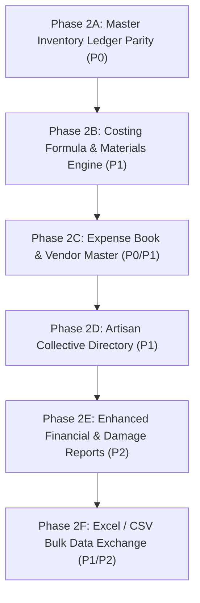

# KALAJAY V2 — COMPLETE LEGACY ERP VS NEW ADMIN PANEL GAP ANALYSIS

**DOCUMENT TYPE:** Architectural Gap Analysis & Parity Assessment  
**STATUS:** Read-Only Audit Completed (Phase 1)  
**STRICT DIRECTIVE:** No implementation or database mutations have been performed. All findings are purely analytical.  
**GOLDEN RULE ENFORCED:** Add, never blindly replace. The intended architecture is a superset preserving all superior V2 features while re-incorporating missing legacy operational capabilities.

---

## 1. Executive Summary

A comprehensive, field-by-field and calculation-by-calculation architectural audit was conducted between:
- **System A (Client's Legacy ERP):** Extracted from `Kalajay_Source_and_Available_Data_2026-11-24.zip` (`source/Kalajay-live/Final/` and `source/KalajayERP-standalone/`), encompassing SQLite schemas, Python backend services (`shared_store.py`, `inventory_costing.py`, `variant_inventory.py`, `expense_store.py`, `team_store.py`, `erp_records.py`), and client-side reactive interfaces (`index.html`, `support.js`, `expenses.html`, `team.html`).
- **System B (Kalajay V2 Admin Panel):** The complete Next.js 14 App Router administration console located in `src/app/admin/`, TypeScript interfaces (`src/data/adminTypes.ts`, `src/data/catalogue.ts`), Firestore backend data stores (`src/lib/firestore.ts`), and secure API endpoints (`src/app/api/admin/*`).

### Global Metric Breakdown:
- **Total Unique Fields / Functional Capabilities Evaluated:** 76
- **Direct Matches (MATCH):** 18 (23.7%)
- **Partially Implemented in V2 (PARTIAL_IN_V2):** 16 (21.1%)
- **Missing from V2 (MISSING_IN_V2):** 21 (27.6%)
- **Useful V2-Only Features to Retain (V2_ONLY):** 15 (19.7%)
- **Equivalent under Different Names (EQUIVALENT_DIFFERENT_NAME):** 5 (6.6%)
- **Architectural / Calculation Conflicts (CONFLICT):** 1 (1.3%)

---

## 2. Core Modules Compared

| Module | Legacy ERP Presence | V2 Admin Panel Presence | Parity State |
| :--- | :---: | :---: | :--- |
| **1. Master Inventory** | 20-column inline editable grid | 8-column tabular view | **Partial (Missing ledger counters & inline margin/valuation)** |
| **2. Materials & Costing** | Dedicated craft formula engine | Manual unit cost entry | **Missing (Need formula: `beadKg*beadCostKg + 50*hours + other`)** |
| **3. Variants & Attributes** | Single-dimension display groups | Multi-dimensional matrix + swatches | **V2 Superior (Retain V2; link variant stock to ledger)** |
| **4. Inventory Transactions** | Explicit 5-type ledger entries | Manual adjustments only | **Partial (Missing dedicated Purchase & Production postings)** |
| **5. Product Management** | Basic catalogue sync | Comprehensive media & specs studio | **V2 Superior (Retain rich V2 media & editorial metadata)** |
| **6. Orders & Invoicing** | Basic list + confirm order | Full courier tracking + PDF invoice | **V2 Superior (Retain serverless PDF generator & outbox)** |
| **7. Shipping & Fulfillment** | None (Binary new/confirmed) | 9-stage fulfillment + AWB tracking | **V2 Superior (Retain white-glove & commercial courier tracking)** |
| **8. Production & Looms** | Simple 'Quantity Made' counter | Digital loom tracking + BOM + QC | **V2 Superior (Retain loom stages; connect output to finished stock)** |
| **9. Expenses & Finance** | Full Expense Book with budgets | Payouts, offline orders, GST slabs | **Missing (Expense ledger & budgets missing in V2)** |
| **10. Vendors & Suppliers** | Official Vendor Master with GST | Plain text field on inventory item | **Missing (Need structured vendor collection & GST records)** |
| **11. Team & Artisans** | Artisan collective directory (21) | Software login accounts only | **Missing (Need artisan craft profiles independent of auth users)** |
| **12. Customers / Patrons** | Embedded order contact strings | Dedicated Patron Circle tier CRM | **V2 Superior (Retain customer circles & lifetime spend)** |
| **13. Bespoke Custom Orders** | None | Dedicated custom inquiry studio | **V2 Superior (Retain custom design workflow)** |
| **14. Corporate Gifting** | None | Milestone gifting & volume tracker | **V2 Superior (Retain B2B corporate gifting module)** |
| **15. Marketing & Coupons** | None | Discount codes & DPDP consent | **V2 Superior (Retain promotional coupon engine)** |
| **16. CMS & Merchandising** | Key-value string table | Visual Section Studio & Banners | **V2 Superior (Retain visual section customization)** |
| **17. Reports & Analytics** | Tabular margins, damage %, headroom | Aggregate charts | **Partial (Incorporate legacy category gross profit table)** |
| **18. Audit Trail** | SQLite trigger-enforced history | Firestore immutable action log | **Match (Both enforce tamper-proof audit histories)** |

---

## 3. High-Priority Gaps (P0 & P1)

### Gap P0-1: Inventory Calculation Conflict & Lack of Ledger Counters
- **Legacy Implementation:** In `KalajayERP/index.html` and `shared_store.py:57`, stock is strictly computed from 7 persistent ledger accumulators:
  $$\text{Remaining Stock} = \text{Opening} + \text{StockIn} + \text{Made} - \text{Sold} - \text{Damaged} - \text{Marketing} + \text{Adjustments}$$
- **V2 Implementation:** In V2 `src/data/adminTypes.ts:117` and `InventoryView.tsx`, `onHand` is a solitary number directly overwritten by manual stock adjustments.
- **Risk:** Without cumulative counters (`open`, `purch`, `made`, `sold`, `dmg`), inventory adjustments overwrite history, making periodic stock audits and loss investigations impossible.
- **Resolution:** Add the 7 accumulator fields to `InventoryItem` and ensure atomic incrementing during operational events.

### Gap P0-2: Complete Absence of Expense Ledger & Budgets in V2
- **Legacy Implementation:** `expense_store.py` contains a complete financial expense book storing date, amount (in paise), category, subcategory, party/vendor, payment method, OPEX/CAPEX treatment, quantity, unit price, notes, up to 3 bill receipt attachments, and monthly category budget thresholds.
- **V2 Implementation:** `FinanceView.tsx` currently only handles payment gateway fee reconciliation, offline POS orders, and GST tax slabs. The entire expense ledger is absent.
- **Resolution:** Add a dedicated **Expense Book** sub-page in V2 `FinanceView` backed by a `expenses` collection in Firestore.

### Gap P1-1: Automated Craft Costing Formula Engine Missing
- **Legacy Implementation:** In `inventory_costing.py`, cost price is determined by artisan formula:
  $$\text{Cost Price (CP)} = \lfloor (\text{beadKg} \times \text{beadCostKg} + 50 \times \text{laborHours} + \text{otherMaterialCost}) \times 100 + 0.5 \rfloor / 100$$
- **V2 Implementation:** `InventoryItem.unitCost` is manually entered without visibility into bead kilogram weights or artisan hourly wages.
- **Resolution:** Add a Costing tab/panel in V2 Catalogue & Inventory modals supporting both live formula auto-calculation and manual override.

### Gap P1-2: Vendor & Supplier Master Directory Missing
- **Legacy Implementation:** `expense_store.py` manages a structured vendor master with `id`, `name`, `gst`, `contact`, `email`, `contracts`, and `knownSince`.
- **V2 Implementation:** `InventoryItem.supplier` is a freeform text string with no tax or contact backing.
- **Resolution:** Provision a `vendors` collection in Firestore and link supplier selection to purchase orders and expense entries.

### Gap P1-3: Rural Artisan Directory vs Software Login Accounts
- **Legacy Implementation:** `team_store.py` maintains an artisan directory storing member codes (e.g. `KJ-ART-001`), craft capacities (Weaver, Finisher, Loom Master), phone, address, emergency contact, joined date, foundational artisan flag (preserving the baseline 21 artisans from Bihar), and portrait photos.
- **V2 Implementation:** `AdminUsersView.tsx` only manages software authentication accounts with passwords for website operators.
- **Resolution:** Create an **Artisan Collective Directory** in V2 ProductionView allowing registration of artisans independently of software login accounts.

---

## 4. Useful V2-Only Capabilities — STRICTLY PRESERVED

Per the Golden Rule, the following 15 advanced features developed for Kalajay V2 must **never be removed or downgraded**:

1. **Multi-Dimensional Dynamic Variant Matrix:** Arbitrary attribute dimensions (Color, Lining, Finish, Hardware) with hex color pickers and swatch images (`src/data/catalogue.ts`).
2. **Reserved Stock & Available-to-Sell Logic:** Dedicated `reserved` counter preventing double-booking during active patron checkouts.
3. **9-Stage Courier & Fulfillment Tracking:** Complete shipping lifecycle (`unfulfilled`, `in_loom`, `quality_checked`, `shipped`, `out_for_delivery`, `delivered`, `rto`) with commercial AWB integration (`ShippingView.tsx`).
4. **Serverless PDF Tax Invoicing:** Automated `pdf-lib` generation of official luxury GST invoices with embedded Kurale typography and QR codes (`invoiceGenerator.ts`).
5. **Durable Transactional Email Outbox:** Resend-backed asynchronous notification queue with automatic exponential backoff retries (`orderEmailDispatcher.ts`).
6. **Digital Loom Tracking & BOM:** Visual loom assignment and Bill of Materials allocation per production batch (`ProductionView.tsx`).
7. **Patron Circle CRM & Tier Management:** Customer tier classification (Heirloom, Connoisseur, Patron, Collector) with lifetime spend metrics (`CustomersView.tsx`).
8. **Bespoke Custom Orders Studio:** Bespoke customer inquiry management with silhouette selection, monogramming, and stage approvals (`CustomOrdersView.tsx`).
9. **Corporate Milestone Gifting Module:** B2B volume gifting portal with budget per piece and sample tracking (`GiftingView.tsx`).
10. **Visual Section Merchandising Studio:** Real-time visual editor for 8 customizable homepage sections (`CmsView.tsx`).
11. **Patron Review Moderation Suite:** Verified-buyer verification, star ratings, and display curation (`CatalogueView.tsx`).
12. **Enterprise RBAC Matrix:** 16 modules, 40+ granular page actions, role inheritance, and username authentication (`RolesPermissionsView.tsx`).
13. **Offline POS & Exhibition Sales:** Studio walk-in and trunk show invoicing with immediate stock deduction (`FinanceView.tsx`).
14. **GST Tax Slabs & Filings Engine:** Automatic CGST/SGST/IGST breakdown by HSN code (`FinanceView.tsx`).
15. **Newsletter & DPDP Consent Management:** Subscriber registry with opt-in timestamps and legal DPDP compliance tracking (`MarketingView.tsx`).

---

## 5. Recommended Implementation Sequence

